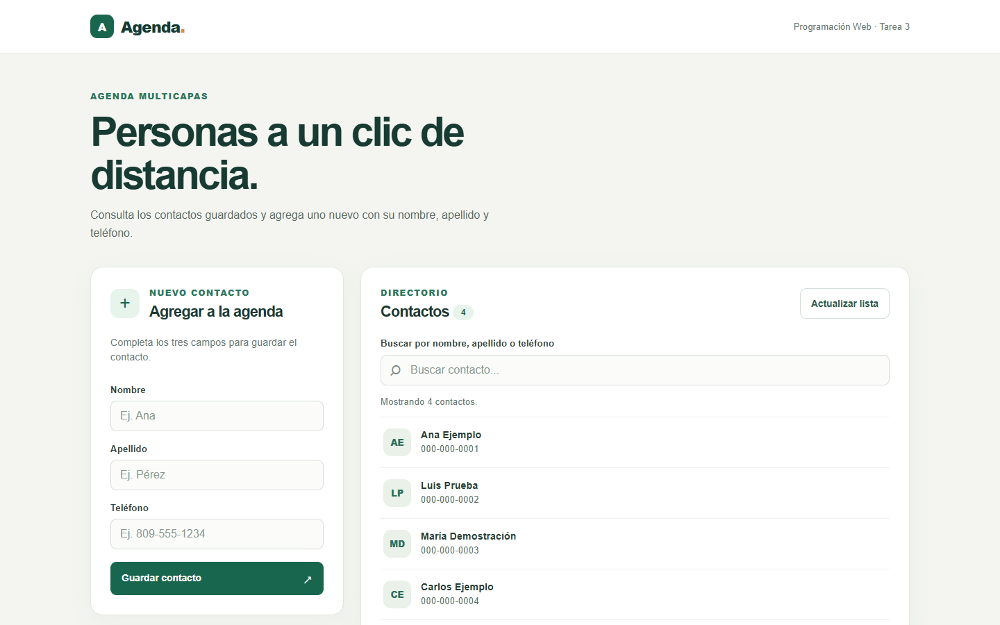
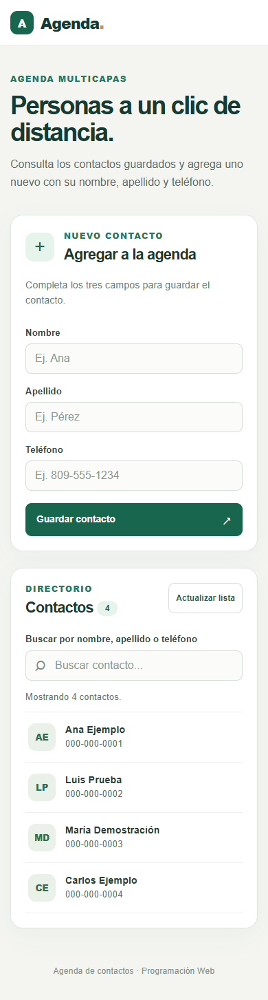

# Agenda Multicapas

Tarea 3 de Programación Web. La página muestra los contactos de la agenda y permite guardar uno nuevo con **nombre, apellido y teléfono**. También incluye una búsqueda dentro de los contactos cargados.

## Vista de la página

Las capturas muestran la aplicación en ejecución con **datos de demostración**. Se usaron para enseñar la interfaz sin publicar los teléfonos de la agenda compartida; al abrir la página normalmente se consultan los datos actuales del servicio.

**Escritorio**



**Móvil**



## Cómo ejecutarla

1. Descarga o clona este repositorio.
2. Desde su carpeta raíz, inicia un servidor local. Por ejemplo, con Python: `python -m http.server 8000`.
3. Abre `http://localhost:8000` en el navegador.

Se necesita conexión a Internet para consultar y guardar contactos. No hay paquetes que instalar ni base de datos local en este proyecto.

## Cómo funciona

- Al abrir la página, `fetch` hace una petición **GET** a `https://www.raydelto.org/agenda.php` y muestra el listado recibido en JSON.
- El formulario toma los tres campos, elimina espacios al inicio y al final, y envía una petición **POST** a la misma URL con `Content-Type: application/json`.
- Después de un envío correcto, la página vuelve a consultar el servicio para actualizar el listado. La búsqueda filtra los contactos que ya están cargados en el navegador.
- Si falla una consulta o un envío, aparece un mensaje en la página. Los datos se guardan en el servicio de la práctica, no en `localStorage`.

El cuerpo enviado por POST tiene esta forma:

```json
{
  "nombre": "Ana",
  "apellido": "Ejemplo",
  "telefono": "000-000-0001"
}
```

Los valores de ese bloque son solo un ejemplo de formato.

## Estructura

```text
AgendaMulticapas/
├── index.html                 Estructura de la página y formulario
├── css/
│   └── styles.css             Estilos y adaptación a móvil
├── js/
│   └── app.js                 Peticiones, listado, búsqueda y formulario
├── img/
│   ├── agenda-escritorio.png  Captura de escritorio
│   └── agenda-movil.png       Captura de móvil
└── README.md                  Instrucciones y explicación
```

Autor: Maxwel Kenen Sael Soriano.
